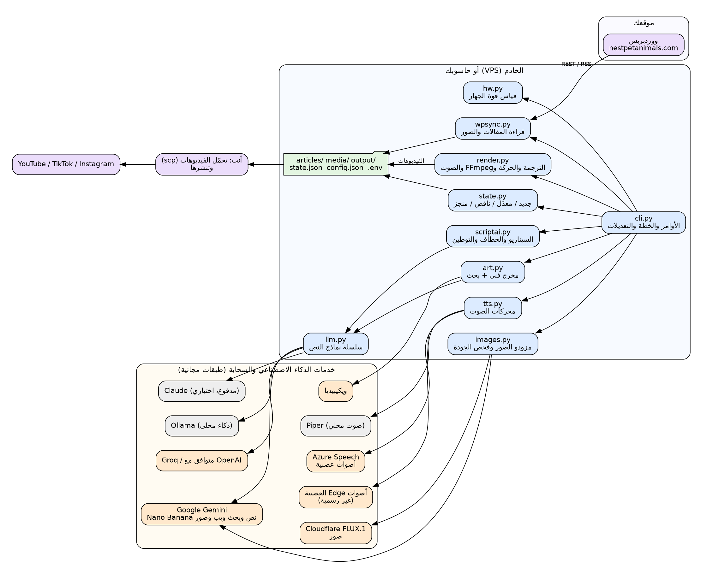
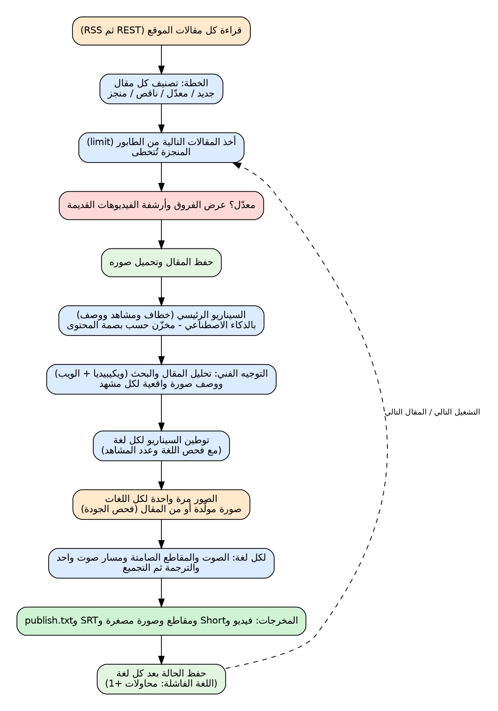

# خط إنتاج الفيديو من المقالات (`ttv`)

[English](README.md) | **العربية**

يقرأ مقالات موقعك على **ووردبريس**، ويحوّل كل مقال تلقائياً إلى فيديوهات جاهزة للنشر على YouTube وYouTube Shorts وTikTok وInstagram
بأربع لغات: **الإنجليزية والفرنسية والعربية والإسبانية**. يعتمد على الطبقات المجانية فقط، بلا اشتراك إلزامي، ويعمل على خادم VPS صغير أو على حاسوبك.

> **تنبيه صدق:** اختُبرت هذه النسخة بـ **خدمات تجريبية محلية** (موقع ووردبريس وهمي، وGemini وCloudflare وAzure وويكيبيديا وOllama وهمية)
> وبـ 38 اختبار وحدة. **لم تُختبر** على الخدمات السحابية الحقيقية، ولم يسمع المطوّر الأصوات الحقيقية. جرّب دائماً مقالاً واحداً (`--limit 1`)
> واستمع إليه قبل النشر. راجع [الحدود](#الحدود-وما-لم-يختبر).

## ماذا ينتج لكل مقال ولكل لغة

| الملف | المحتوى |
|---|---|
| `video_16x9.mp4` | فيديو أفقي لـ YouTube |
| `short_9x16.mp4` | فيديو عمودي أقل من 58 ثانية: الخطاف أولاً ونداء القراءة أخيراً (Shorts / TikTok / Reels) |
| `minis/mini_XX_9x16.mp4` | مقاطع عمودية نحو 35 ثانية، تُنتج فقط إن كان الفيديو طويلاً |
| `thumbnail.jpg` و`subtitles.srt` و`publish.txt` | صورة مصغرة، وترجمة YouTube، والعنوان والوصف والهاشتاغات وتعليقات TikTok وInstagram |

داخل الفيديو: **خطاف** في أول جملة، وجمل قصيرة منطوقة، و**صور واقعية بالذكاء الاصطناعي** اختارها «مخرج فني» درس المقال،
وحركة بطيئة (تكبير وتمرير)، وترجمة نصية متحركة (3 كلمات عمودياً و6 أفقياً)، ومسار صوت واحد متصل بوقفات طبيعية، وعربية صحيحة من اليمين لليسار.

## بداية سريعة (خادم Ubuntu 24.04)

التفاصيل الكاملة في [docs/OPERATIONS.ar.md](docs/OPERATIONS.ar.md).

1. **على حاسوبك** (PowerShell): `scp .\free-content-pipeline.zip root@IP:/root/`
2. `ssh root@IP` ثم: `apt-get update && apt-get install -y unzip && cd /root && unzip -o free-content-pipeline.zip && cd free-content-pipeline`
3. `bash scripts/server_setup.sh` (FFmpeg والخطوط والأصوات والجدار الناري والذكاء المحلي وفحص نهائي).
   إن كانت نسخة قديمة مثبّتة: استعمل `unzip -o ... -x "free-content-pipeline/config.json"` ثم `bash scripts/upgrade.sh`.
4. `nano .env` وأضف مفاتيحك **المجانية** (انظر [المفاتيح](#المفاتيح-ولكلها-طبقة-مجانية)). الحد الأدنى: `GEMINI_API_KEY`.
5. `./venv/bin/python pipeline.py --doctor` (يجب أن يظهر كل شيء ok) ثم `./venv/bin/python pipeline.py --test-ai` (جمل مترجمة للتجربة).
6. `tmux` ثم `./venv/bin/python pipeline.py --site --limit 1`.
7. التحميل من حاسوبك: `scp -r root@IP:/root/free-content-pipeline/output .` ثم استمع وانشر.
8. تشغيل تلقائي كل ليلة: `bash scripts/install_cron.sh`.

## الأوامر

| الهدف | الأمر (داخل مجلد المشروع) |
|---|---|
| فحص الجهاز والمفاتيح والأصوات والخطوط | `./venv/bin/python pipeline.py --doctor` |
| ترجمة جملة تجريبية لكل اللغات | `... --test-ai` |
| معالجة المقال التالي من الموقع | `... --site --limit 1` |
| **عرض ما أُنجز وما فشل لكل مقال** | `... --status` |
| العمل على مقال محدد (حتى لو أُنجز) | `... --site --only اسم-المقال` |
| إعادة المقالات المنجزة أيضاً (بعد الجديدة) | `... --site --force` |
| إعادة محاولة لغات فشلت 3 مرات | `... --site --retry-failed` |
| السيناريو فقط بلا فيديو | `... --site --dry-run` |
| لغات أو أحجام محددة | `--langs en,fr` / `--formats tall` |
| المقالات المعدّلة: أعد بناءها الآن (عندما `on_edit` يساوي `report_only`) | `... --site --apply-edits` |
| ملف مقال واحد | `... articles/my-post.md` |
| فرض ملف قوة | `--profile lite|standard|strong|max` |
| حجم كل مقال والمساحة الحرة | `... --disk` |
| إعادة لغة واحدة من مقال | `... --site --only اسم-المقال --langs fr` |
| حذف لغة أو مقال (يسأل YES أولاً) | `... --delete-lang اسم-المقال fr` / `... --delete-post اسم-المقال [--keep-ignored]` |
| عدم معالجة مقال / معالجته من جديد | `... --ignore-post اسم-المقال` / `... --unignore-post اسم-المقال` |
| حذف النسخ القديمة المؤرشفة / ذاكرة البحث | `... --prune-archive 30` / `... --clean-cache` |

## المقالات لا تتكرر أبداً

كل تشغيل يقارن الموقع بالملف `state.json`. المقال في حالة واحدة فقط:

`جديد (new)` ← `ناقص (partial)` أو `منجز (complete)`؛ والتعديل يجعله `معدّل (edited)`؛ واللغة التي تفشل 3 مرات تجعله `تم التوقف (gave_up)`.
ترتيب الطابور: **الجديد ثم المعدّل ثم الناقص**. المقالات المنجزة تُتخطى، فتشغيل `--limit 1` مراراً **ينتقل للمقال التالي**.
ولغة فاشلة لا تعطّل بقية المقالات أبداً. انظر [المخطط 03](docs/diagrams/ar/03-post-states.png).

**المقالات المعدّلة** تُكتشف ببصمة النص (وليس بتاريخ التعديل). عند اكتشاف تعديل ترى الفروق في الشاشة وفي
`output/_reports/edits.md`، ثم (حسب الإعداد `on_edit`):

* `archive` (الافتراضي): تُنقل الفيديوهات القديمة إلى `output/_archive/<slug>/rev<N>_<date>/`، وتُصنع الجديدة في `output/<slug>/` مع ملف `CHANGELOG.md`.
* `new_folder`: تبقى القديمة مكانها، وتُصنع الجديدة في `output/<slug>--rev<N+1>/`.
* `report_only`: لا يُعاد بناء شيء حتى تشغّل `--apply-edits`.

تغيّر التاريخ مع بقاء النص نفسه يُسجَّل ويُتجاهل.

## الجودة

* **السيناريو:** يقرأ الذكاء الاصطناعي المقال كاملاً ويكتب خطافاً ومشاهد قصيرة من حقائق المقال فقط، ثم **يوطّن** (لا ترجمة حرفية) لكل لغة مع فحوص: اللغة الصحيحة وعدد المشاهد نفسه. والنماذج المحلية الصغيرة تنتقل لترجمة نصية جملة جملة.
* **الصور** ([art.py](ttv/art.py)): تحليل المقال (السلالة والمكان والجو) ← بحث عن شكل الأشياء الحقيقية (ويكيبيديا، وبحث Google عبر Gemini) ← وصف تصوير مفصّل لكل مشهد بلقطات متنوعة ← توليد (Nano Banana ثم Cloudflare FLUX) ← فحص جودة (ليست صغيرة ولا فارغة) ← صور المقال الأصلية احتياطاً. تُحفظ الأوصاف في `output/<slug>/assets/prompts.json`.
* **الصوت:** Azure العصبي (رسمي، طبقة مجانية) ← Edge العصبي (مجاني غير رسمي) ← Piper (دون إنترنت) ← أصوات النظام. مسار صوت واحد متصل لكل فيديو، ووقفة 0.45 ثانية بعد الجملة، وشدة −16 LUFS، وترميز AAC مرة واحدة.

## المفاتيح (ولكلها طبقة مجانية)

تُوضع في `.env` (لا تشاركه أبداً). والأمر `--doctor` يخبرك بما ينقص.

| المفتاح | ما يعطيك | من أين |
|---|---|---|
| `GEMINI_API_KEY` | السيناريو والترجمة والبحث على الويب وصور Nano Banana | aistudio.google.com/apikey |
| `AZURE_SPEECH_KEY` و`AZURE_SPEECH_REGION` | أفضل الأصوات (طبقة مجانية 500,000 حرف شهرياً) | بوابة Azure ← مورد Speech (الفئة F0) |
| `CLOUDFLARE_ACCOUNT_ID` و`CLOUDFLARE_API_TOKEN` | صور FLUX.1 (مجاني 10,000 neuron يومياً) | dash.cloudflare.com ← AI ← Workers AI |
| `LLM_API_KEY` (اختياري) | Groq نموذجاً نصياً ثانياً | console.groq.com |
| `ANTHROPIC_API_KEY` (اختياري، **مدفوع**) | أفضل جودة للسيناريو | console.anthropic.com |

الحصص المجانية تتغير. وبلا أي مفتاح يعمل المشروع بالنموذج المحلي (`bash scripts/install_ai.sh`) وصور المقال نفسه، بجودة أقل.

## الإعدادات

الملف `config.json` (المفاتيح الناقصة تأخذ قيماً افتراضية آمنة): `site_url` و`brand` و`target_langs` و`formats` و`profile` و`posts_per_run` و`order` و`on_edit` و`max_attempts`
و`short_max_seconds` و`mini_seconds` و`minis` و`music` و`ai_images` و`art_director` و`image_providers` و`image_style` و`image_negative` و`research`
و`llm` (الترتيب والنماذج) و`tts_order` و`tts_order_by_lang` و`tts_voices` و`gap_sentence` و`gap_clause` و`loudness` و`transition` و`font`.
متغيرات البيئة: `PIPELINE_CONFIG` (ملف إعدادات آخر) و`TTV_HOME` (مجلد بيانات آخر).
قوة الجهاز تُقاس تلقائياً (`hw.py`): `lite` بدقة 720p، و`standard` و`strong` و`max` بدقة 1080p وعمل متوازٍ أكثر.

## شجرة المشروع

```
free-content-pipeline/
├── pipeline.py              نقطة التشغيل (الأمر المعتاد)
├── config.json  .env  .env.example  requirements.txt
├── ttv/                     البرنامج
│   ├── cli.py               الأوامر والتخطيط ومعالجة التعديلات
│   ├── postflow.py          مقال واحد ← كل لغاته
│   ├── state.py             دورة حياة المقال: جديد / معدّل / ناقص / منجز
│   ├── wpsync.py            قارئ ووردبريس (REST وRSS) والصور وبصمة المحتوى
│   ├── scriptai.py          السيناريو والخطاف والتوطين والسيناريو الاحتياطي
│   ├── art.py               المخرج الفني: تحليل وبحث وأوصاف الصور
│   ├── llm.py               سلسلة نماذج النص: Gemini وGroq وClaude وOllama
│   ├── images.py            Nano Banana وCloudflare FLUX وفحص الجودة
│   ├── tts.py               الأصوات: Azure وEdge وGemini وPiper وWindows وespeak
│   ├── render.py            الخطوط والترجمة والحركة ومسار الصوت وFFmpeg
│   ├── manage.py            أوامر المساحة والحذف والتجاهل والتنظيف
│   ├── langs.py  hw.py  config.py  report.py  doctor.py
├── scripts/                 server_setup.sh  upgrade.sh  install_ai.sh  install_cron.sh  *.bat
├── tests/                   mocks.py (خدمات تجريبية)  test_state.py  test_parts.py
├── docs/                    ARCHITECTURE  OPERATIONS  REVIEW (إنجليزي وعربي)  diagrams/{en,ar}
├── articles/  media/  music/  voices/  output/  state.json   (بياناتك، تُنشأ تلقائياً)
```

## المخططات

كل المخططات بالإنجليزية والعربية (SVG وPNG) في `docs/diagrams/en` و`docs/diagrams/ar`.





المزيد: [الحالات](docs/diagrams/ar/03-post-states.png) · [بناء الصوت والفيديو](docs/diagrams/ar/04-audio-video-build.png) · [سلاسل الاحتياط](docs/diagrams/ar/05-provider-fallbacks.png) · [النشر على الخادم](docs/diagrams/ar/06-deployment.png) · [المجلدات](docs/diagrams/ar/07-folders.png) · [الوحدات](docs/diagrams/ar/08-modules.png).
لإعادة بنائها: `python3 docs/diagrams/build_diagrams.py` (يحتاج Graphviz).

## التوثيق

* [docs/ARCHITECTURE.ar.md](docs/ARCHITECTURE.ar.md): كل وحدة والبيانات والقواعد ونقاط التوسعة
* [docs/OPERATIONS.ar.md](docs/OPERATIONS.ar.md): التثبيت والتحديث والمفاتيح والتشغيل اليومي والانتقال لخادم أقوى وحل الأخطاء والأمان
* [docs/REVIEW.md](docs/REVIEW.md): مراجعة النسخة السابقة: ما الخطأ ودليله وإصلاحه (بالعربية والإنجليزية)
* [CHANGELOG.md](CHANGELOG.md)

## الاختبارات

```
python3 tests/test_state.py && python3 tests/test_parts.py && python3 tests/test_robustness.py        # 38 اختبار وحدة بلا إنترنت
python3 tests/mocks.py 8765                                       # خدمات وهمية للتجريب دون اتصال
```

## الحدود وما لم يُختبر

* لم يُختبر على Gemini وGroq وClaude وCloudflare وAzure وEdge وويكيبيديا الحقيقية (فقط على محاكيات تنسخ شكل طلباتها الموثّق). والحصص المجانية وأسماء النماذج تتغير.
* جودة الأصوات الحقيقية مجهولة للمطوّر: استمع أولاً. صوت Piper العربي يتوقع نصاً مشكولاً ويُرجَّح أنه ضعيف؛ استعمل Azure أو Edge للعربية.
* توقيت الترجمة النصية دقيق فقط مع أصوات Edge (توقيت الكلمات)، وإلا فهو تقدير من طول النص.
* الصور ثابتة مع تكبير وتمرير، وليست توليد فيديو (Veo مدفوع بالثانية ولم يُضَف). والصور المولّدة قد تحوي أخطاء: راجع أول فيديوهات كل موضوع، خاصة نصائح الصحة والغذاء.
* النشر على المنصات يدوي. أنت المسؤول عن حقوق الموسيقى والصور وعن قواعد كل منصة بشأن المحتوى المولّد بالذكاء الاصطناعي.
