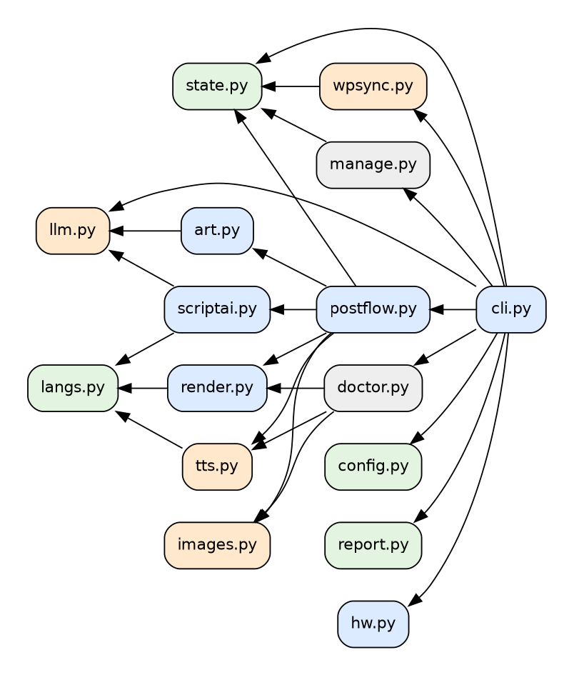
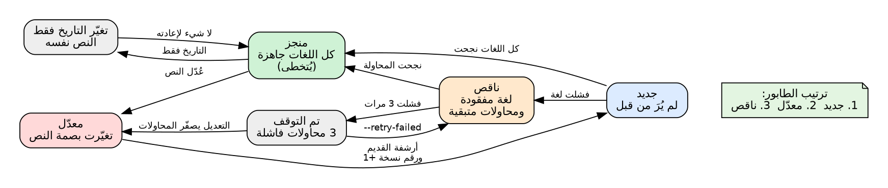
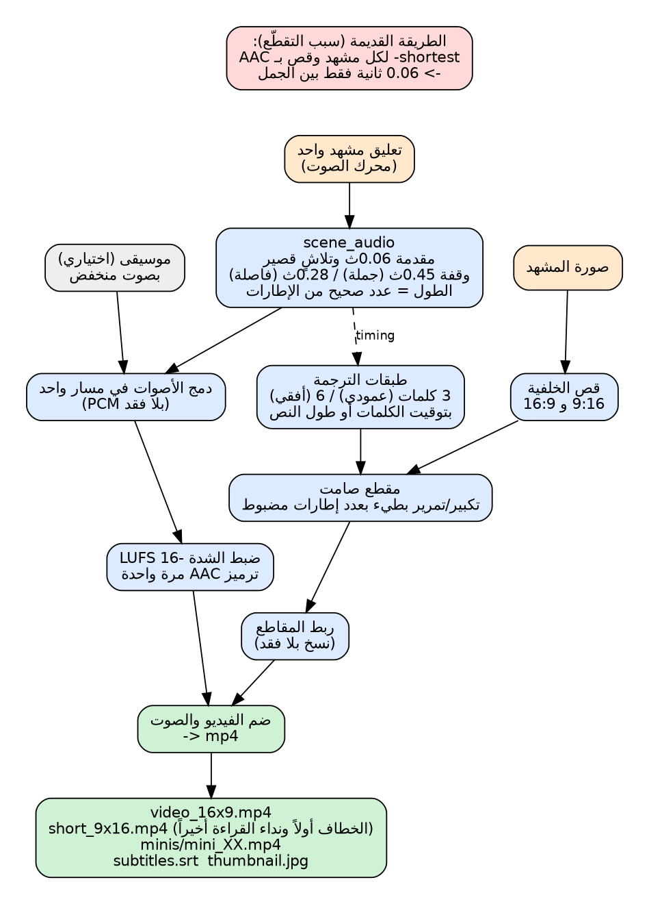
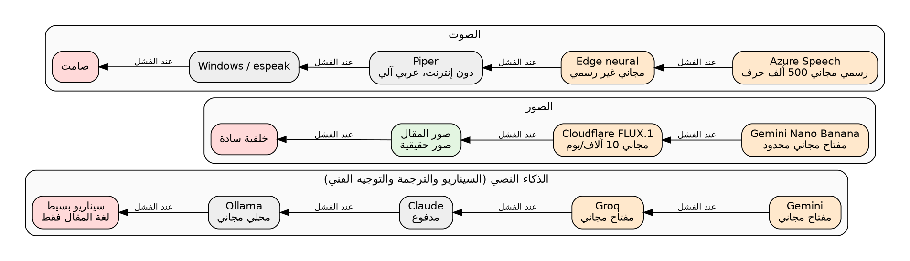
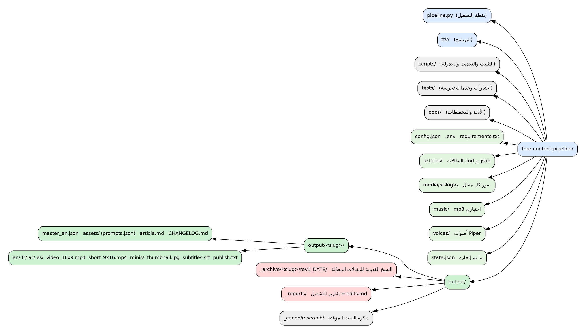

# البنية المعمارية

**العربية** | [English](ARCHITECTURE.md) · العودة إلى [README](../README.ar.md)


## 1. المبادئ

1. **مقال واحد وحالة واحدة.** يحفظ `state.json` كل مقال (جديد أو معدّل أو ناقص أو منجز أو متوقَّف عنه)، فلا يتكرر عمل ولا يضيع شيء.
2. **كل شيء مخزّن مؤقتاً.** السيناريو والتوجيه الفني والبحث والصور وسيناريو كل لغة تُحفظ وتُعاد الاستفادة منها، فإعادة التشغيل لا تكلّف شيئاً للعمل المنجز.
3. **لكل طبقة بديل.** مزوّد ذكاء أو صور أو صوت يفشل لا يوقف التشغيل، بل ينتقل للتالي. وإن لم ينجح شيء يقول الخط ذلك بصدق بدل صنع فيديو خاطئ.
4. **لا فيديو بلغة خاطئة أبداً.** تُفحص الترجمة (اللغة الصحيحة وعدد المشاهد نفسه)، وإلا تُتخطى اللغة وتُحسب محاولة فاشلة.
5. **الصوت مسار واحد متصل.** المشاهد مقاطع صامتة، والصوت يُبنى على حدة، ويُرمَّز مرة واحدة ثم يُضم.
6. **البيانات منفصلة عن الكود.** المتغير `TTV_HOME` ينقل المقالات والوسائط والنتائج والحالة و`.env` إلى مكان آخر (تستعمله الاختبارات).

## 2. الوحدات (`ttv/`)

| الوحدة | المسؤولية | تعتمد على |
|---|---|---|
| `cli.py` | المعاملات وفحص الموقع والخطة ومعالجة التعديلات والتقارير | كل ما يلي |
| `postflow.py` | مقال واحد إلى كل لغاته، وحفظ الحالة بعد كل لغة | `scriptai art images tts render state` |
| `state.py` | `state.json` النسخة 2 و`classify` و`plan` وفروق التعديل والأرشفة | لا شيء |
| `wpsync.py` | واجهة REST لووردبريس (واحتياطاً RSS) وتحويل HTML لنص والصور وبصمة المحتوى | `state` |
| `config.py` | الافتراضيات ودمج `config.json` وتحميل `.env` و`ROOT` | لا شيء |
| `hw.py` | قياس الذاكرة والمعالجات وذاكرة البطاقة، والملفات `lite standard strong max` | لا شيء |
| `llm.py` | سلسلة نماذج النص: Gemini وGroq وClaude وOllama، مع إعادة المحاولة وفحص الإجابة وبحث Gemini على الويب ومساعد تثبيت Ollama | لا شيء |
| `scriptai.py` | السيناريو الرئيسي (خطاف ومشاهد ووصف) والتوطين مع فحوص والترجمة النصية الاحتياطية والسيناريو البسيط | `llm langs` |
| `art.py` | المخرج الفني: `analyze` ثم `research` ثم `prompts` و`final_prompt` | `llm` |
| `images.py` | صور Gemini (Nano Banana) وCloudflare FLUX وفحص الجودة والتعامل مع الرفض | لا شيء |
| `tts.py` | Azure وEdge (توقيت الكلمات) وGemini TTS وPiper وWindows وespeak وصامت، مع ترتيب لكل لغة وقاطع دائرة | `langs` |
| `render.py` | الخطوط مع فحص الحروف والنص من اليمين لليسار وطبقات الترجمة والمقاطع الصامتة ومسار الصوت والتجميع والمقاطع القصيرة والصورة المصغرة وSRT | `langs` |
| `langs.py` | سجل اللغات (الأصوات ونداء القراءة وجملة الاختبار والكلمات الشائعة) والاكتشاف | لا شيء |
| `report.py` و`doctor.py` | تقارير الخطة والتعديل والتشغيل، و`--doctor` و`--test-ai` و`--status` | `state` وغيرها |



## 3. مقال واحد خطوة بخطوة


1. تقرأ `wpsync.fetch_posts` كل المقالات المنشورة وتحسب `text` و`hash = md5(العنوان + النص)`.
2. تصنّف `state.plan` كل مقال وتبني الطابور.
3. لكل مقال في الطابور: معالجة التعديل (الفروق والأرشفة) ثم `wpsync.save_post` (المقال والرابط والصور).
4. `postflow.process_post`:
   1. السيناريو الرئيسي بلغة المقال (مخزّن في `master_<lang>.json` ببصمة المحتوى)؛
   2. التوجيه الفني (مخزّن داخل ملف السيناريو الرئيسي)؛
   3. سيناريو كل لغة مطلوبة (مخزّن في `<lang>/script.json` مع بصمة السيناريو الرئيسي)؛
   4. يُفرَّغ نموذج الذكاء من الذاكرة، وتُصنع الصور **مرة واحدة**، ثم لكل لغة: الصوت والمقاطع والصوت المتصل والتجميع؛
   5. `state.mark_done` أو `mark_failed` ثم `state.save` بعد كل لغة.

## 4. حالات المقال



الملف `state.json` (النسخة 2):

```json
{"_version": 2, "posts": {"12": {
  "slug": "why-cats-purr", "title": "...", "link": "...", "modified": "...", "content_hash": "md5",
  "revision": 2, "first_seen": "2026-10-20 10:00:00",
  "langs": {"en": {"status": "done", "at": "...", "revision": 2},
            "fr": {"status": "failed", "attempts": 2, "last_error": "translation: ...", "at": "..."}},
  "history": [{"revision": 1, "hash": "...", "title": "...", "archived": "output/_archive/...", "summary": {"added": 1, "removed": 2}}]}}}
```

القواعد: معدّل = تغيّرت البصمة؛ وتغيّر التاريخ وحده يُتجاهل؛ ولغة بلغت `attempts >= max_attempts` تُتخطى حتى `--retry-failed` أو تعديل؛
وترتيب الطابور: جديد ثم معدّل ثم ناقص (ثم المطلوب بالقوة)؛ والمقال يحتفظ باسم المجلد الذي أخذه أول مرة حتى لو تغيّر رابطه الدائم؛
وملف الحالة القديم (النسخة 1) يُحوَّل تلقائياً؛ ويُكتب الملف بطريقة ذرّية.

## 5. السيناريو والتوطين والتوجيه الفني

* `scriptai.master_script`: قواعد المطالبة: حقائق المقال فقط، وخطاف بحد أقصى 12 كلمة، ومن 5 إلى 12 مشهداً بـ 10 إلى 24 كلمة، وآخر مشهد نداء قراءة، وتلميح `visual` بالإنجليزية، وعنوان ووصف و8 هاشتاغات وتعليقا TikTok وInstagram. تُنظَّف الإجابة (`normalize`) أو تُرفض.
* `scriptai.localize`: يترجم التعليق والعنوان والوصف والهاشتاغات والتعليقات على دفعات صغيرة مفحوصة؛ يتحقق من اللغة (`langs.is_lang`) ومن عدم النسخ دون ترجمة ومن الطول؛ وإن فشل JSON مرتين يترجم **جملة جملة بنص عادي**. تلميحات الصور تُنسخ ولا تُترجم.
* `art.analyze` يعيد الموضوع والكيانات (سلالات وأطعمة...) و**وصفاً واحداً للموضوع المتكرر** (الحيوان نفسه في كل صورة) والمكان والجو وما يجعل هذه الصور تبدو مزيّفة.
* `art.research`: لكل كيان ملخص ويكيبيديا (واجهة رسمية)، ومع مفتاح Gemini إجابة مبنية على بحث Google عن شكل الكيان الحقيقي. تُخزَّن في `output/_cache/research/` وتُحفظ المصادر في ملف السيناريو الرئيسي.
* `art.prompts`: وصف تصوير من 40 إلى 70 كلمة لكل مشهد بلقطات متنوعة؛ يُفحص العدد والطول. و`art.final_prompt` يضيف أسلوب الواقعية والاستثناءات (`image_style` و`image_negative`).

## 6. الصور

`postflow.make_visuals`: اسم ملف كل مشهد يحوي بصمة الوصف، فتغيير وصف يعيد توليد تلك الصورة فقط. الترتيب: صورة مولّدة ← صورة المقال نفسه ← خلفية متدرجة. المزوّد الذي يرفض بـ HTTP 401/402/403 يُتخطى بقية التشغيل، وثلاثة إخفاقات أخرى توقفه أيضاً. ويسجّل `assets/prompts.json` مصدر كل صورة.

## 7. بناء الصوت والفيديو



* `render.scene_audio`: التعليق ← PCM ستيريو بمقدمة 0.06 ثانية وتلاشٍ 15 و40 ملّي ثانية ووقفة (0.45 ثانية بعد نهاية الجملة و0.28 غير ذلك)؛ والطول **عدد صحيح من الإطارات**.
* `render.render_scene`: مقطع صامت بهذا العدد من الإطارات تماماً؛ تكبير أو تصغير أو تمرير بالتناوب؛ وطبقات الترجمة صور PNG تتبدل في وقتها عبر قائمة ffconcat، فلا يتحرك النص ولا يُقصّ.
* `render.assemble`: تُربط المقاطع بلا فقد، وتُدمج أصوات المشاهد بلا فقد، وتُمزج مع موسيقى اختيارية، وتُضبط الشدة (`loudnorm`)، وتُرمَّز AAC **مرة واحدة**، ثم يُضم الفيديو والصوت. والدالة نفسها تبني الفيديو الطويل والـ Short (الخطاف أولاً ونداء القراءة أخيراً وبحد `short_max_seconds`) والمقاطع القصيرة.
* الترجمة: مجموعات من 3 كلمات (عمودي) أو 6 (أفقي)؛ التوقيت من توقيت كلمات الصوت إن وُجد (Edge) وإلا تقدير من طول النص وعلامات الترقيم؛ وآخر مجموعة تبقى حتى نهاية المشهد.
* الخطوط: قبل الرسم يتحقق `render.find_font` أن الخط يحوي كل حروف النص (فلا مربعات فارغة)؛ والعربية بتشكيل Raqm، واحتياطاً `arabic-reshaper` و`python-bidi`.

## 8. المزوّدون والبدائل



| الطبقة | الترتيب (الافتراضي) | ملاحظات |
|---|---|---|
| النص | Gemini ← Groq ← Claude ← Ollama | `llm.order`؛ كل طلب يُعاد (429: انتظار 20 ثانية، 5xx: 5 ثوانٍ، JSON فاسد: مرة) |
| الصور | Gemini ← Cloudflare ← صور المقال ← سادة | `image_providers`؛ حُذف Pollinations (صار يردّ HTTP 402) |
| الصوت | Azure ← Edge ← Piper ← Windows ← espeak ← صامت | `tts_order` و`tts_order_by_lang`؛ محرك يفشل مرتين يُتخطى؛ غياب المفتاح ليس فشلاً |

## 9. المجلدات والبيانات



## 10. نقاط التوسعة

* **لغة جديدة:** أضف عنصراً في `langs.LANGS` (الاسم والأصوات ونداء القراءة وجملة الاختبار والكلمات الشائعة)، وأضف صوت Piper في `scripts/server_setup.sh`، وأضف الرمز إلى `target_langs`.
* **مزوّد نص جديد:** أضف `_make_<name>` في `llm.LLM` يعيد `Provider`، وضع اسمه في `llm.order`.
* **مزوّد صور أو صوت جديد:** أضف دالة إلى `images.PROVIDERS` أو `tts.ENGINES` وإلى قائمة الترتيب.
* **النشر على YouTube أو ووردبريس:** اقرأ `output/<slug>/<lang>/publish.txt` وملفات mp4؛ ولا يلزم تغيير النواة.

## 11. الاختبارات

`tests/test_state.py` (15 اختباراً): جديد ومنجز وناقص وتوقف ومعدّل مقابل تغيّر التاريخ وتقرير فقط والترتيب و`--only` والمحذوف والترحيل والفروق.
`tests/test_parts.py` (15 اختباراً): طول الإطارات والوقفات ودمج صوت بلا فجوات وترجمة بتوقيت الكلمات وبدائل الصوت وقاطع الدائرة وترتيب لكل لغة وفحص جودة الصور والرفض وفحص التوجيه الفني والخطوط واكتشاف اللغة والسيناريو الاحتياطي.
`tests/mocks.py`: ووردبريس وهمي مع Gemini (نص وبحث وصورة وصوت) وCloudflare وAzure وويكيبيديا وOllama، ونقطة تحكم لتعديل المقالات وإفشال لغة؛ وتُستعمل في تشغيلات النهاية إلى النهاية.
