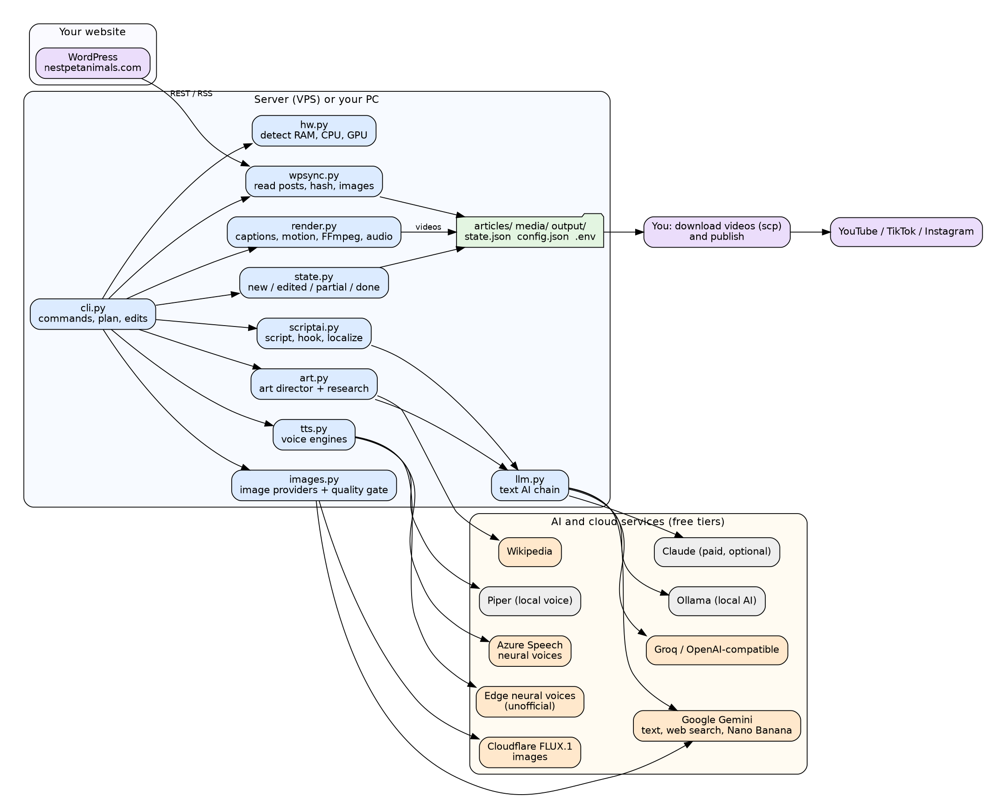
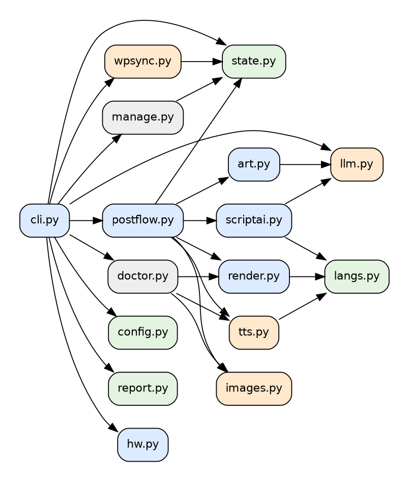
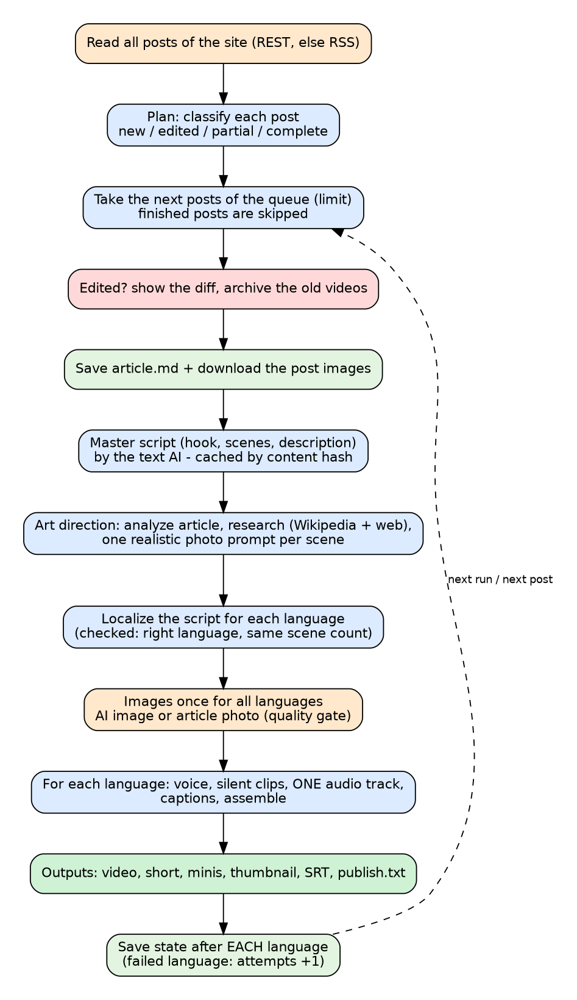
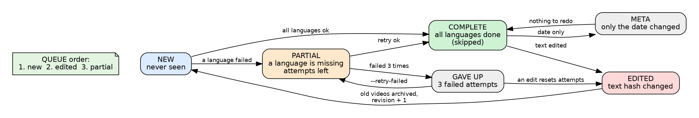
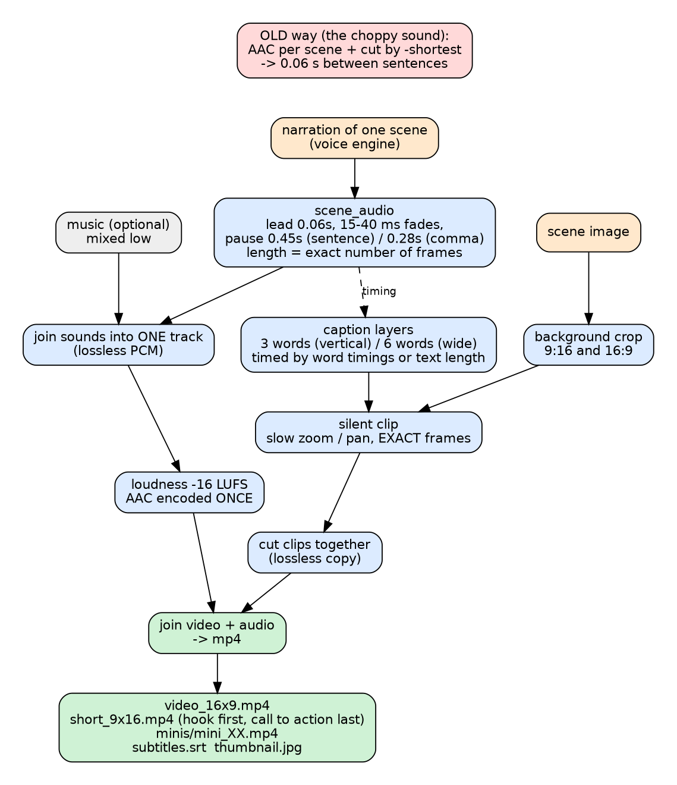
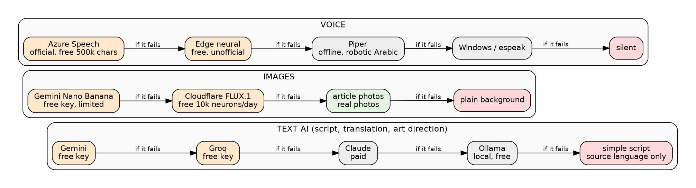
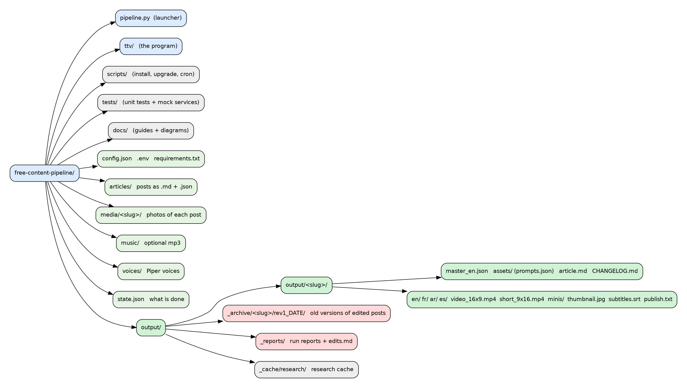

# Architecture

[العربية](ARCHITECTURE.ar.md) | **English** · back to [README](../README.md)



## 1. Principles

1. **One post, one state.** `state.json` remembers every post (new, edited, partial, complete, gave up) so nothing is repeated and nothing is lost.
2. **Everything is cached.** Script, art direction, research, images and per-language scripts are saved and reused. A re-run costs nothing for finished work.
3. **Every layer has a fallback.** A failing AI provider, image provider or voice engine never stops the run; it moves to the next one. When nothing works the run says so honestly instead of producing a wrong video.
4. **Never a video in the wrong language.** Translations are validated (right language, same number of scenes); otherwise the language is skipped and counted as a failed attempt.
5. **The sound is one continuous track.** Scenes are silent clips; audio is built separately, encoded once, then joined.
6. **Data never lives in the code folder logic.** `TTV_HOME` moves articles, media, output, state and `.env` elsewhere (used by tests).

## 2. Modules (`ttv/`)

| Module | Responsibility | Depends on |
|---|---|---|
| `cli.py` | arguments, site check, plan, edit handling, reports | all below |
| `postflow.py` | one post to all its languages; saves state after each language | `scriptai art images tts render state` |
| `state.py` | `state.json` v2, `classify`, `plan`, edit diff, archive | none |
| `wpsync.py` | WordPress REST (fallback RSS), HTML to text, images, content hash | `state` |
| `config.py` | defaults, deep-merge of `config.json`, `.env` loader, `ROOT` | none |
| `hw.py` | measures RAM / cores / GPU memory; profiles `lite standard strong max` | none |
| `llm.py` | text AI chain Gemini, Groq/OpenAI-compatible, Claude, Ollama; retries, validation callback, Gemini web search, Ollama install helper | none |
| `scriptai.py` | master script (hook, scenes, metadata), localization with checks, plain-text fallback, simple fallback script | `llm langs` |
| `art.py` | art director: `analyze` → `research` → `prompts`, plus `final_prompt` | `llm` |
| `images.py` | Gemini image (Nano Banana), Cloudflare FLUX, quality gate, refusal handling | none |
| `tts.py` | Azure, Edge (word timings), Gemini TTS, Piper, Windows SAPI, espeak, silent; order per language; circuit breaker | `langs` |
| `render.py` | fonts with glyph check, right-to-left text, caption layers, silent clips, audio track, assembly, minis, thumbnail, SRT | `langs` |
| `langs.py` | language registry (voices, call to action, sample text, stop words), detection | none |
| `report.py`, `doctor.py` | plan / edit / run reports; `--doctor`, `--test-ai`, `--status` | `state` and others |



## 3. One post, step by step



1. `wpsync.fetch_posts` reads all published posts and computes `text` and `hash = md5(title + text)`.
2. `state.plan` classifies each post and builds the queue.
3. For each queued post: edit handling (diff, archive), `wpsync.save_post` (article, link, photos).
4. `postflow.process_post`:
   1. master script in the article's language (cached in `master_<lang>.json` by hash);
   2. art direction (cached inside the master file);
   3. every needed language script (cached in `<lang>/script.json` with the master hash);
   4. the AI model is unloaded; images are made **once**; then for each language voice, clips, audio, assembly;
   5. `state.mark_done` / `mark_failed` and `state.save` after each language.

## 4. Post states



`state.json` (version 2):

```json
{"_version": 2, "posts": {"12": {
  "slug": "why-cats-purr", "title": "...", "link": "...", "modified": "...", "content_hash": "md5",
  "revision": 2, "first_seen": "2026-10-20 10:00:00",
  "langs": {"en": {"status": "done", "at": "...", "revision": 2},
            "fr": {"status": "failed", "attempts": 2, "last_error": "translation: ...", "at": "..."}},
  "history": [{"revision": 1, "hash": "...", "title": "...", "archived": "output/_archive/...", "summary": {"added": 1, "removed": 2}}]}}}
```

Rules: edited = hash changed; date-only change is ignored; a language with `attempts >= max_attempts` is skipped until `--retry-failed` or an edit;
the queue order is new, edited, partial (then forced); a post keeps the folder name it first got, even if its permalink changes; a state file from version 1 is migrated automatically; the file is written atomically.

## 5. Script, localization and art direction

* `scriptai.master_script`: rules in the prompt: use only facts of the article, hook of at most 12 words, 5–12 scenes of 10–24 words, last scene = call to action, English `visual` hint, title, description, 8 hashtags, TikTok and Instagram captions. The answer is normalized (`normalize`) or rejected.
* `scriptai.localize`: translates narration, title, description, hashtags and captions in small validated chunks; checks language (`langs.is_lang`), copy-without-translating, length; if JSON fails twice it translates **one sentence at a time as plain text**. Visual hints are copied, never translated.
* `art.analyze` returns the topic, the entities (breeds, foods...), one **recurring subject description** (same animal in every image), setting, mood and what makes such photos look fake.
* `art.research`: for each entity, Wikipedia summary (official API) and, with a Gemini key, a Google-Search-grounded answer about how the real subject looks. Cached in `output/_cache/research/`. Sources are saved in the master file.
* `art.prompts`: one 40–70 word photographic prompt per scene with varied shots; count and length are validated. `art.final_prompt` appends the realism style and the exclusions (`image_style`, `image_negative`).

## 6. Images

`postflow.make_visuals`: for each scene the file name contains a hash of the prompt, so changing a prompt regenerates only that image. Order: AI image → the post's own photo → plain gradient. A provider refused with HTTP 401/402/403 is skipped for the rest of the run; three other failures also stop it. `assets/prompts.json` records the source of every image.

## 7. Sound and video build



* `render.scene_audio`: narration → stereo PCM with a 0.06 s lead, 15 ms / 40 ms fades, and a pause (0.45 s after a sentence end, 0.28 s otherwise); the length is an **exact number of frames**.
* `render.render_scene`: silent clip of exactly that many frames; slow zoom in, zoom out or pan (rotating); caption layers are PNGs changed on time through an ffconcat list, so the text never moves or gets cropped.
* `render.assemble`: clips are joined losslessly; scene sounds are joined losslessly, mixed with optional music, normalised (`loudnorm`) and encoded to AAC **once**; then video and audio are joined. The same function builds the video, the short (hook first, call to action last, at most `short_max_seconds`) and the minis.
* Captions: chunks of 3 words (vertical) or 6 (wide); timing from the voice's word timings when available (Edge), else estimated from text length and punctuation; the last chunk stays until the end of the scene.
* Fonts: before drawing, `render.find_font` checks that the font has every glyph of the text (so no empty boxes); Arabic uses Raqm shaping, with `arabic-reshaper` + `python-bidi` as fallback.

## 8. Providers and fallbacks



| Layer | Order (default) | Notes |
|---|---|---|
| text | Gemini → Groq → Claude → Ollama | `llm.order`; each call retried (429: wait 20 s; 5xx: 5 s; bad JSON: once) |
| images | Gemini → Cloudflare → article photos → plain | `image_providers`; Pollinations was removed (it now answers HTTP 402) |
| voice | Azure → Edge → Piper → Windows → espeak → silent | `tts_order`, `tts_order_by_lang`; an engine failing twice is skipped; a missing key is not a failure |

## 9. Folders and data



## 10. Extension points

* **A new language**: add an entry in `langs.LANGS` (name, voices, call to action, sample, stop words), add the Piper voice in `scripts/server_setup.sh`, add the code to `target_langs`.
* **A new text provider**: add `_make_<name>` in `llm.LLM` returning a `Provider`, and put the name in `llm.order`.
* **A new image or voice provider**: add a function to `images.PROVIDERS` or `tts.ENGINES` and to the order list.
* **Posting to YouTube / WordPress**: read `output/<slug>/<lang>/publish.txt` and the mp4 files; nothing in the core needs to change.

## 11. Tests

`tests/test_state.py` (15 tests): new, complete, partial, gave up, edited vs date-only, report-only, ordering, `--only`, removed, migration, diff.
`tests/test_parts.py` (15 tests): exact frame length and pauses, gapless joined audio, word-timed captions, voice fallback and circuit breaker, language-specific order, image quality gate and refusal, art validation, fonts, language detection, fallback script.
`tests/mocks.py`: fake WordPress + Gemini (text, search, image, tts) + Cloudflare + Azure + Wikipedia + Ollama, with a control endpoint to edit posts and to make a language fail; used for the end-to-end runs.
