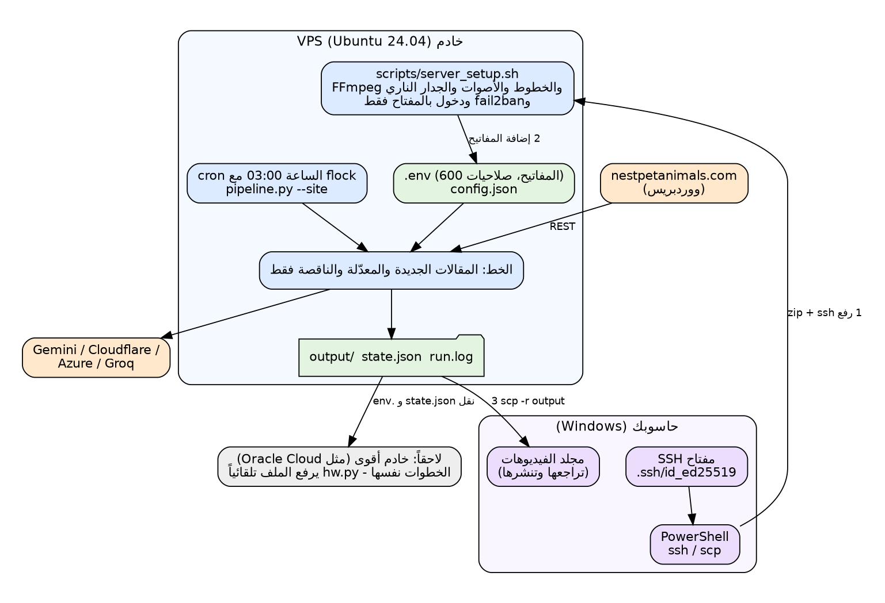

# دليل التشغيل

**العربية** | [English](OPERATIONS.md) · العودة إلى [README](../README.ar.md)



## 1. ما تحتاجه

* خادم: Ubuntu 24.04 بمعالجين و4 GB ذاكرة كحد أدنى (8 GB أفضل)، ولا حاجة لبطاقة شاشة. خادم VPS يبدأ من نحو 5 يورو شهرياً. اشترِ **شهراً واحداً** أولاً.
* موقعك على ووردبريس (مقالات منشورة علناً؛ ويُستحسن أن يفتح العنوان `https://موقعك/wp-json/wp/v2/posts` في المتصفح، وإلا استُعمل RSS).
* مفاتيح مجانية (القسم 3). وبدونها يعمل المشروع بجودة أقل.

## 2. التثبيت الأول على VPS

على **حاسوبك** (PowerShell)، وليس داخل الخادم:

```
ssh-keygen -t ed25519                                   # مرة واحدة؛ اضغط Enter عند كل سؤال
Get-Content $env:USERPROFILE\.ssh\id_ed25519.pub | clip # الصق هذا المفتاح العام في خانة SSH public key عند المزوّد
cd $env:USERPROFILE\Downloads
scp .\free-content-pipeline.zip root@IP:/root/
ssh root@IP
```

داخل الخادم:

```
apt-get update && apt-get install -y unzip
cd /root && unzip -o free-content-pipeline.zip && cd free-content-pipeline
bash scripts/server_setup.sh        # من 5 إلى 15 دقيقة. والأمر SKIP_AI=1 bash scripts/server_setup.sh يتخطى تنزيل الذكاء المحلي
nano .env                           # أضف مفاتيحك (Ctrl+O ثم Enter ثم Ctrl+X)
./venv/bin/python pipeline.py --doctor
./venv/bin/python pipeline.py --test-ai
tmux
./venv/bin/python pipeline.py --site --limit 1
```

ما يفعله `server_setup.sh`: تحديث النظام؛ وتثبيت FFmpeg وPython والخطوط (ومنها العربية) وespeak وtmux؛ والجدار الناري (ufw) وfail2ban؛ وبيئة Python؛
وأصوات Piper للغات ar وen وfr وes مع اختبار كل صوت؛ وedge-tts؛ وإنشاء `.env` (صلاحيات 600)؛ و**تعطيل** الدخول بكلمة المرور إذا وُجد مفتاح SSH؛
وتثبيت نموذج الذكاء المحلي (Ollama) المناسب للجهاز؛ ثم تشغيل `--doctor`.

> قبل إغلاق نافذتك الأولى افتح PowerShell ثانية وتأكد أن `ssh root@IP` يعمل بالمفتاح.

تحميل النتائج (من حاسوبك): `scp -r root@IP:/root/free-content-pipeline/output .`

## 3. المفاتيح المجانية

أسماء القوائم تتغير، والفكرة ثابتة. ضع كل قيمة في `.env` بعد علامة `=` دون علامات اقتباس ولا مسافات.

| المفتاح | الخطوات |
|---|---|
| `GEMINI_API_KEY` | aistudio.google.com/apikey ← أنشئ API key. يُستعمل للسيناريو والترجمة والبحث على الويب وصور Nano Banana. **لا** تفعّل الفوترة إن أردت البقاء مجانياً. |
| `AZURE_SPEECH_KEY` و`AZURE_SPEECH_REGION` | portal.azure.com ← أنشئ مورد **Speech** بفئة **Free F0** ← Keys and Endpoint: انسخ KEY 1 والموقع Location (مثل `westeurope`). الطبقة المجانية: 500,000 حرف عصبي شهرياً (مقال بأربع لغات يستهلك تقريباً بين 3,000 و5,000). قد يطلب Azure بطاقة للتحقق. |
| `CLOUDFLARE_ACCOUNT_ID` و`CLOUDFLARE_API_TOKEN` | dash.cloudflare.com ← AI ← Workers AI ← «Use REST API»: انسخ Account ID وأنشئ API token بصلاحية Workers AI. مجاني: 10,000 neuron يومياً، أي نحو 100 صورة بـ 6 خطوات الافتراضية. |
| `LLM_API_KEY` (اختياري) | console.groq.com ← API keys. نموذج نصي مجاني ثانٍ. |
| `ANTHROPIC_API_KEY` (اختياري، مدفوع) | console.anthropic.com. أفضل جودة للسيناريو، ويُحاسَب بالاستعمال. |

ثم شغّل `--doctor`: يعرض سلسلة الذكاء النصي ومزوّدي الصور والصوت المستعمل لكل لغة وهل يوجد خط يغطي كل لغة.
الحصص المجانية والأسعار تتغير: راجعها في صفحة كل مزوّد.

## 4. تحديث خادم موجود (مع بقاء بياناتك)

```
# على حاسوبك: ارفع الملف المضغوط الجديد كما سبق، ثم على الخادم:
cd /root
unzip -o free-content-pipeline.zip -x "free-content-pipeline/config.json"
cd free-content-pipeline
bash scripts/upgrade.sh
```

يحذف `upgrade.sh` ملفات الوحدات القديمة (صارت في `ttv/` و`scripts/`)، ويثبّت المكتبات، ويضيف أسطر المفاتيح الجديدة إلى `.env`، ويرحّل `config.json`
(الأصوات العصبية أولاً، وحذف Pollinations، وإضافة Cloudflare). أما `state.json` فيُرحَّل تلقائياً: المقالات المنجزة تبقى منجزة.

## 5. الاستعمال اليومي

```
./venv/bin/python pipeline.py --status                  # ما أُنجز وما فشل لكل مقال
./venv/bin/python pipeline.py --site --limit 1          # المقال التالي (المنجزة تُتخطى)
./venv/bin/python pipeline.py --site --dry-run          # ماذا سيحدث، السيناريوهات فقط
```

* **تلقائي:** `bash scripts/install_cron.sh` يشغّل `pipeline.py --site` كل ليلة الساعة 03:00 (ولا يسمح بتشغيلين معاً). السجل: `tail -50 run.log`. وللإزالة: `crontab -e`.
* **كل تشغيل ينتهي بتقرير:** `output/_reports/run-التاريخ.md`.
* **لا تكرار:** المقالات المنجزة تُتخطى. ولإعادة مقال عمداً: `--site --only اسم-المقال`.
* **لغة فشلت:** تُعاد في التشغيلات التالية (3 محاولات) ثم تُتخطى. أصلح السبب (مفتاح أو حصة أو نموذج) ثم `--site --retry-failed`.
* **استمع أولاً:** حمّل مقالاً واحداً واستمع إلى كل لغة ثم انشر. غيّر الأصوات بـ `tts_voices` و`tts_order_by_lang` في `config.json`.
* **النشر:** استعمل `publish.txt` (العنوان والوصف والهاشتاغات والتعليقات) و`subtitles.srt` لـ YouTube و`thumbnail.jpg`. والرفع يدوي.
* **القرص:** الفيديو الواحد بضعة ميغابايت. حمّل ثم احذف المجلدات القديمة في `output/` (وأبقِ `state.json`).

### المقالات المعدّلة

عند تعديل مقال في الموقع يطبع التشغيل التالي الفرق (جمل مضافة ومحذوفة وتغيّر العنوان) ويكتبه في `output/_reports/edits.md`.
والإعداد `on_edit` في `config.json`:

| القيمة | النتيجة |
|---|---|
| `archive` (الافتراضي) | تُنقل الفيديوهات القديمة إلى `output/_archive/<slug>/rev<N>_<date>/`؛ والجديدة في `output/<slug>/`؛ ومعها `CHANGELOG.md` |
| `new_folder` | تبقى القديمة مكانها؛ والجديدة في `output/<slug>--rev<N+1>/` |
| `report_only` | تقرير فقط؛ وتعيد البناء متى قررت بـ `--site --apply-edits` |

وإذا تغيّر تاريخ «modified» فقط والنص نفسه، يذكر التشغيل ذلك ولا يفعل شيئاً.

## 6. إدارة العمل وإعادته وحذفه

كل أمر حذف **يطلب منك كتابة YES** أولاً (أضف `--yes` لتخطي السؤال). فلا يُحذف شيء بالخطأ.

| الهدف | الأمر (داخل مجلد المشروع على الخادم) |
|---|---|
| عرض ما أُنجز وما فشل وما ينقص | `./venv/bin/python pipeline.py --status` |
| حجم كل مقال والمساحة الحرة | `./venv/bin/python pipeline.py --disk` |
| **إعادة** مقال كاملاً | `./venv/bin/python pipeline.py --site --only اسم-المقال` |
| إعادة لغة واحدة من مقال | `./venv/bin/python pipeline.py --site --only اسم-المقال --langs fr` |
| **حذف** لغة واحدة من مقال (تُبنى في التشغيل التالي) | `./venv/bin/python pipeline.py --delete-lang اسم-المقال fr` |
| **حذف** مقال (الفيديوهات والصور والنص والحالة) | `./venv/bin/python pipeline.py --delete-post اسم-المقال` |
| حذف مقال وعدم إعادة بنائه أبداً | `./venv/bin/python pipeline.py --delete-post اسم-المقال --keep-ignored` |
| عدم معالجة مقال (مع إبقاء ملفاته) / معالجته من جديد | `... --ignore-post اسم-المقال` / `... --unignore-post اسم-المقال` |
| حذف مقال مع نسخه القديمة المؤرشفة | `... --delete-post اسم-المقال --include-archive` |
| حذف النسخ المؤرشفة الأقدم من 30 يوماً | `./venv/bin/python pipeline.py --prune-archive 30` |
| حذف ذاكرة البحث المؤقتة | `./venv/bin/python pipeline.py --clean-cache` |
| إعادة محاولة لغات فشلت 3 مرات | `./venv/bin/python pipeline.py --site --retry-failed` |
| إعادة بناء المقالات المعدّلة التي اكتفيت بالإبلاغ عنها | `./venv/bin/python pipeline.py --site --apply-edits` |

المقال المحذوف بـ `--delete-post` **ما زال في موقعك**، فيبنيه التشغيل التالي من جديد، إلا إن أضفت `--keep-ignored`.
ولإعادة توليد صور مقال فقط: احذف المجلد `output/<slug>/assets` ثم شغّل `--only`. ولإعادة كتابة سيناريو مقال: احذف `output/<slug>/master_*.json` وملفات `script.json` ثم `--only`.
وأوامر Linux العادية تعمل أيضاً: `rm -rf output/<slug>/fr` يحذف مجلداً، لكن `state.json` سيظل يقول إنه منجز؛ فالأفضل الأوامر أعلاه.

## 7. الانتقال إلى خادم أقوى (مثل Oracle Cloud)

1. أنشئ الخادم (Ubuntu 24.04) وضع مفتاح SSH. حسب علمي تقدّم Oracle Cloud جهاز ARM «Always Free» بذاكرة كبيرة، لكنها تطلب بطاقة للتحقق وتوفره يختلف حسب المنطقة: راجع الشروط الحالية. ولم يُختبر المشروع على ARM (عادةً تعمل FFmpeg وPython وPillow؛ وإن تعذّر تثبيت Piper تُستعمل أصوات Edge أو Azure).
2. ارفع الملف المضغوط وشغّل `server_setup.sh` ثم `--doctor`: يقيس `hw.py` الجهاز الجديد ويرفع الملف تلقائياً (1080p وعمل متوازٍ ونموذج محلي أكبر).
3. انقل تاريخك كي لا يُعاد شيء: انسخ `state.json` و`.env` من الخادم القديم إلى الجديد (عبر حاسوبك بـ `scp`). وأبقِ `config.json` الجديد واضبط `site_url` فقط.
4. شغّل `--status` ثم `--site --limit 1` ثم `scripts/install_cron.sh`.
5. أوقف الدفع للخادم القديم (أطفئ التجديد التلقائي).

## 8. Windows (استعمال محلي لأعمال صغيرة)

شغّل `scripts\install_windows.bat` مرة، وانسخ `.env.example` إلى `.env`، ثم `scripts\run.bat` (بلا معاملات = `--site`) أو `scripts\run.bat --doctor`. تُستعمل أصوات Windows ما لم تضع مفاتيح Azure أو تثبّت `edge-tts` (`pip install edge-tts`). والحاسوب القديم سيكون بطيئاً.

## 9. حل الأخطاء

| العَرَض | السبب | الحل |
|---|---|---|
| المقال نفسه يتكرر | (النسخة القديمة) لغة فاشلة كانت تعيده للطابور، أو استُعمل `--force` | أُصلح: المنجزة تُتخطى. استعمل `--status`. ولا تستعمل `--force` بانتظام |
| `'bool' object has no attribute 'get'` أو انهيار عند البداية | (النسخة 2.0.0) إعداد بنوع خاطئ في `config.json` | أُصلح في 2.0.1: حدّث. صار الإعداد الخاطئ يُحوَّل أو يُتجاهل مع رسالة |
| كل شيء بطيء جداً ويُستعمل Ollama فقط | نموذج 4B على 3 معالجات | أضف `GEMINI_API_KEY` (مجاني): أسرع بكثير وأفضل، ثم `--doctor` |
| العربية تبدو معكوسة في الطرفية | الطرفية لا تدعم الكتابة من اليمين لليسار | ليست علة: الفيديو سليم. افحص النص في `output/<slug>/ar/script.json` أو شاهد الفيديو |
| `NO AI TEXT MODEL FOUND` | لا مفتاح ولا Ollama | أضف `GEMINI_API_KEY` أو `bash scripts/install_ai.sh` |
| لغة `gave up` | 3 محاولات فاشلة | اقرأ الخطأ في `--status` وأصلحه ثم `--retry-failed` |
| `translation failed ... not written in ...` | النموذج الصغير أجاب بلغة خاطئة | استعمل Gemini أو Groq، أو نموذج Ollama أكبر (`bash scripts/install_ai.sh gemma3:12b`) |
| `image provider ... refused (HTTP 402/403)` | مفتاح أو خطة خاطئة | افحص المفتاح وخطة المزوّد؛ ويتابع التشغيل بالمزوّد التالي أو صور المقال |
| الصور هي صور المقال فقط | لا مفتاح صور أو انتهت الحصة | أضف `GEMINI_API_KEY` أو مفاتيح Cloudflare؛ والحصص تتجدد يومياً |
| عربية آلية أو متقطعة | استُعمل Piper أو espeak | ضع `AZURE_SPEECH_KEY` و`AZURE_SPEECH_REGION` أو `pip install edge-tts`؛ و`--doctor` يعرض الصوت لكل لغة |
| فيديو صامت | لم ينجح أي محرك صوت | `--doctor` وانظر قائمة المحركات |
| مربعات فارغة بدل الحروف | الخط لا يحوي الحروف | يكشفه `--doctor`؛ ثبّت `fonts-noto-core` أو حدّد `font` |
| `could not read any post` | الشبكة معطلة أو العنوان خاطئ أو REST محجوبة | افتح `<الموقع>/wp-json/wp/v2/posts` في المتصفح؛ وافحص `site_url`. ولا يتغير شيء في هذه الحالة |
| `Killed` أثناء البناء | نفاد الذاكرة | `--profile lite` أو `--formats tall` أو لغات أقل |
| `Permission denied (publickey)` | المفتاح لا يطابق | ادخل من وحدة تحكم المزوّد على الويب وأعد وضع مفتاحك العام |
| `scp: stat local ... No such file` | كُتب الأمر داخل الخادم | يُنفَّذ `scp` على **حاسوبك** |
| القرص ممتلئ | كبر `output/` | حمّل ثم احذف المجلدات القديمة |

## 10. الأمان والنسخ الاحتياطي

* المفاتيح في `.env` فقط (صلاحيات 600)؛ لا في `config.json` ولا في محادثة ولا في لقطة شاشة. وإن تسرّب مفتاح فاحذفه عند المزوّد وأنشئ غيره.
* الدخول بمفتاح SSH فقط؛ والمفتاح **الخاص** هو الملف بلا `.pub`: لا ترسله أبداً. احتفظ بنسخة من `C:\Users\أنت\.ssh` في مكان آمن.
* الجدار الناري وfail2ban يفعّلهما `server_setup.sh`.
* انسخ `state.json` و`config.json` و`.env` و`output/` دورياً إلى حاسوبك.
* قد تستعمل الطبقات المجانية لبعض خدمات Google النصوص المرسلة لتحسين منتجاتها. والمقالات المنشورة علنية أصلاً؛ فلا ترسل نصوصاً خاصة.
* الحقوق: أنت المسؤول عن الموسيقى والصور التي تضيفها وعن قواعد كل منصة بشأن المحتوى المولّد بالذكاء الاصطناعي.
