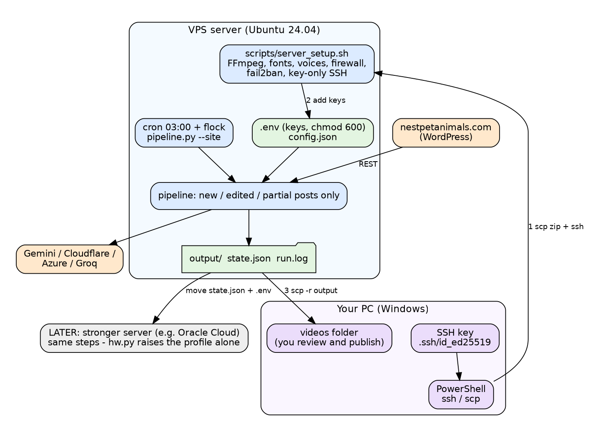

# Operations guide

[العربية](OPERATIONS.ar.md) | **English** · back to [README](../README.md)



## 1. What you need

* A server: Ubuntu 24.04, 2 vCPU and 4 GB RAM minimum (8 GB better), no GPU needed. A VPS from about 5 euros per month. Buy **one month** first.
* Your WordPress site (public posts; the REST address `https://your-site/wp-json/wp/v2/posts` should open in a browser; otherwise RSS is used).
* Free keys (section 3). Without keys the project still works at lower quality.

## 2. First install on a VPS

On **your PC** (PowerShell), not inside the server:

```
ssh-keygen -t ed25519                                   # once; press Enter at every question
Get-Content $env:USERPROFILE\.ssh\id_ed25519.pub | clip # paste this PUBLIC key in the provider's "SSH public key" box
cd $env:USERPROFILE\Downloads
scp .\free-content-pipeline.zip root@IP:/root/
ssh root@IP
```

Inside the server:

```
apt-get update && apt-get install -y unzip
cd /root && unzip -o free-content-pipeline.zip && cd free-content-pipeline
bash scripts/server_setup.sh        # 5-15 minutes. SKIP_AI=1 bash scripts/server_setup.sh  skips the local AI download
nano .env                           # add your keys (Ctrl+O, Enter, Ctrl+X)
./venv/bin/python pipeline.py --doctor
./venv/bin/python pipeline.py --test-ai
tmux
./venv/bin/python pipeline.py --site --limit 1
```

`server_setup.sh` does: system update; FFmpeg, Python, fonts (Arabic included), espeak, tmux; firewall (ufw) and fail2ban; the Python environment;
Piper voices for ar / en / fr / es with a test of each; edge-tts; creates `.env` (mode 600); turns password login **off** when an SSH key exists; installs the local AI model (Ollama) chosen for the machine; runs `--doctor`.

> Before closing your first window, open a second PowerShell and check `ssh root@IP` works with the key.

Download the results (PC): `scp -r root@IP:/root/free-content-pipeline/output .`

## 3. The free keys

Menu names change; the idea stays the same. Put each value in `.env` after the `=`, no quotes, no spaces.

| Key | Steps |
|---|---|
| `GEMINI_API_KEY` | aistudio.google.com/apikey → create an API key. Used for scripts, translation, web research and Nano Banana images. Do **not** turn on billing if you want to stay free. |
| `AZURE_SPEECH_KEY`, `AZURE_SPEECH_REGION` | portal.azure.com → create a **Speech** resource, pricing tier **Free F0** → Keys and Endpoint: copy KEY 1 and the Location (for example `westeurope`). Free tier: 500,000 neural characters per month (a post in 4 languages uses roughly 3,000–5,000). An Azure account may ask for a card to verify you. |
| `CLOUDFLARE_ACCOUNT_ID`, `CLOUDFLARE_API_TOKEN` | dash.cloudflare.com → AI → Workers AI → "Use REST API": copy the Account ID and create an API token with the Workers AI permission. Free: 10,000 neurons per day, which is roughly 100 images with the default 6 steps. |
| `LLM_API_KEY` (optional) | console.groq.com → API keys. A second free text model. |
| `ANTHROPIC_API_KEY` (optional, paid) | console.anthropic.com. Best script quality; billed per use. |

Then run `--doctor`: it lists the AI text chain, image providers, the voice used per language and whether a font covers every language.
Free quotas and prices change: check them on each provider's page.

## 4. Upgrade an existing server (keeps your data)

```
# on your PC: upload the new zip as before, then on the server:
cd /root
unzip -o free-content-pipeline.zip -x "free-content-pipeline/config.json"
cd free-content-pipeline
bash scripts/upgrade.sh
```

`upgrade.sh` removes the old module files (they now live in `ttv/` and `scripts/`), installs the libraries, adds the new key lines to `.env`, and migrates `config.json`
(neural voices first, removes Pollinations, adds Cloudflare). `state.json` is migrated automatically: finished posts stay finished.

## 5. Daily use

```
./venv/bin/python pipeline.py --status                  # what is done / failed for every post
./venv/bin/python pipeline.py --site --limit 1          # next post (finished posts are skipped)
./venv/bin/python pipeline.py --site --dry-run          # check what would happen, scripts only
```

* **Automatic**: `bash scripts/install_cron.sh` runs `pipeline.py --site` every night at 03:00 (never two at once). Log: `tail -50 run.log`. Remove: `crontab -e`.
* **A run always ends with a report**: `output/_reports/run-DATE.md`.
* **Never repeats**: finished posts are skipped. To redo one on purpose: `--site --only the-slug`.
* **A language failed**: it is retried on the next runs (3 attempts), then skipped. Fix the cause (key, quota, model), then `--site --retry-failed`.
* **Listen first**: download one post, listen to each language, then publish. Change voices with `tts_voices` / `tts_order_by_lang` in `config.json`.
* **Publishing**: use `publish.txt` (title, description, hashtags, captions), `subtitles.srt` for YouTube, `thumbnail.jpg`. Upload by hand.
* **Disk**: each video is a few MB. Download, then delete old folders in `output/` (keep `state.json`).

### Edited posts

When you edit a post on the site, the next run prints the difference (sentences added / removed, title change) and writes it to `output/_reports/edits.md`.
Setting `on_edit` in `config.json`:

| Value | Result |
|---|---|
| `archive` (default) | old videos moved to `output/_archive/<slug>/rev<N>_<date>/`; new videos in `output/<slug>/`; `CHANGELOG.md` inside |
| `new_folder` | old videos stay; new ones in `output/<slug>--rev<N+1>/` |
| `report_only` | only reports; rebuild when you decide with `--site --apply-edits` |

If only the "modified" date changed and the text is identical, the run says so and does nothing.

## 6. Managing, redoing and deleting work

Every deleting command **asks you to type YES** first (add `--yes` to skip the question). Nothing is deleted by accident.

| Goal | Command (inside the project folder, on the server) |
|---|---|
| See what is done / failed / missing | `./venv/bin/python pipeline.py --status` |
| See disk usage per post and free space | `./venv/bin/python pipeline.py --disk` |
| **Redo** one post completely | `./venv/bin/python pipeline.py --site --only the-slug` |
| Redo one language of a post | `./venv/bin/python pipeline.py --site --only the-slug --langs fr` |
| **Delete** one language of a post (rebuilt on the next run) | `./venv/bin/python pipeline.py --delete-lang the-slug fr` |
| **Delete** a post (videos, photos, article, state) | `./venv/bin/python pipeline.py --delete-post the-slug` |
| Delete a post and never rebuild it | `./venv/bin/python pipeline.py --delete-post the-slug --keep-ignored` |
| Never process a post (keep its files) / process it again | `... --ignore-post the-slug` / `... --unignore-post the-slug` |
| Delete a post and also its archived old versions | `... --delete-post the-slug --include-archive` |
| Delete archived old versions older than 30 days | `./venv/bin/python pipeline.py --prune-archive 30` |
| Delete the research cache | `./venv/bin/python pipeline.py --clean-cache` |
| Retry languages that failed 3 times | `./venv/bin/python pipeline.py --site --retry-failed` |
| Rebuild edited posts you only reported | `./venv/bin/python pipeline.py --site --apply-edits` |

A post deleted with `--delete-post` is **still on your website**, so the next run builds it again, unless you add `--keep-ignored`.
To regenerate only the images of a post, delete its `output/<slug>/assets` folder and run `--only`. To rewrite its script, delete `output/<slug>/master_*.json` and the `script.json` files, then `--only`.
Plain Linux commands also work: `rm -rf output/<slug>/fr` removes a folder, but then `state.json` still says it is done; prefer the commands above.

## 7. Moving to a bigger server (for example Oracle Cloud)

1. Create the server (Ubuntu 24.04), add your SSH key. As far as I know Oracle Cloud offers an "Always Free" ARM machine with a large memory, but it asks for a card to verify you and availability depends on the region: check the current terms. ARM has not been tested with this project (FFmpeg, Python and Pillow normally work; if Piper cannot install, Edge or Azure voices are used).
2. Upload the zip and run `server_setup.sh`, then `--doctor`: `hw.py` measures the new machine and raises the profile by itself (1080p, parallel work, a bigger local model).
3. Move your history so nothing is redone: copy `state.json` and `.env` from the old server to the new one (through your PC with `scp`). Keep the new server's `config.json` and only set `site_url`.
4. Run `--status`, then `--site --limit 1`, then `scripts/install_cron.sh`.
5. Stop paying the old server (turn off its auto-renew).

## 8. Windows (local use, small jobs)

Run `scripts\install_windows.bat` once, copy `.env.example` to `.env`, then `scripts\run.bat` (no argument = `--site`) or `scripts\run.bat --doctor`. The Windows voices are used unless you set Azure keys or install `edge-tts` (`pip install edge-tts`). An old PC will be slow.

## 9. Troubleshooting

| Symptom | Cause | Fix |
|---|---|---|
| The same post again and again | (old version) a failing language re-queued it; or `--force` was used | fixed: finished posts are skipped. Use `--status`. Do not use `--force` routinely |
| `'bool' object has no attribute 'get'` or another crash at the start | (old 2.0.0) a setting with the wrong type in `config.json` | fixed in 2.0.1: upgrade. A bad setting is now converted or ignored with a message |
| everything is very slow, only Ollama is used | a 4B model on 3 CPU cores | add `GEMINI_API_KEY` (free): much faster and better, then `--doctor` |
| Arabic looks reversed in the terminal | the terminal does not support right-to-left text | not a bug: the video is fine. Check the text in `output/<slug>/ar/script.json` or watch the video |
| `NO AI TEXT MODEL FOUND` | no key and no Ollama | add `GEMINI_API_KEY`, or `bash scripts/install_ai.sh` |
| a language is `gave up` | 3 failed attempts | read the error in `--status`, fix it, `--retry-failed` |
| `translation failed ... not written in ...` | small model answered in the wrong language | use Gemini / Groq, or a bigger Ollama model (`bash scripts/install_ai.sh gemma3:12b`) |
| `image provider ... refused (HTTP 402/403)` | wrong key or plan | check the key and the provider's plan; the run continues with the next provider / article photos |
| images are the article's photos only | no image key, or quota used | add `GEMINI_API_KEY` or the Cloudflare keys; quotas reset daily |
| robotic / choppy Arabic | Piper or espeak was used | set `AZURE_SPEECH_KEY` / `AZURE_SPEECH_REGION` or `pip install edge-tts`; run `--doctor` to see the voice per language |
| silent video | no voice engine worked | `--doctor`; see the engines list |
| empty boxes instead of letters | the font lacks the glyphs | `--doctor` shows it; `apt install fonts-noto-core` or set `font` |
| `could not read any post` | network down, wrong address, REST blocked | open `<site>/wp-json/wp/v2/posts` in a browser; check `site_url`. Nothing is changed in that case |
| `Killed` during render | out of memory | `--profile lite`, `--formats tall`, fewer `--langs` |
| `Permission denied (publickey)` | key mismatch | use the provider's web console, add your public key again |
| `scp: stat local ... No such file` | the command was typed inside the server | `scp` is run on **your PC** |
| disk full | `output/` grew | download then delete old folders |

## 10. Security and backups

* Keys only in `.env` (mode 600); never in `config.json`, chats or screenshots. If a key leaks, delete it at the provider and make a new one.
* SSH key login only; the **private** key is the file without `.pub`: never send it. Keep a copy of `C:\Users\you\.ssh` somewhere safe.
* Firewall and fail2ban are enabled by `server_setup.sh`.
* Back up `state.json`, `config.json`, `.env` and `output/` regularly to your PC.
* Free tiers of some Google services may use the text you send to improve products. Published posts are public anyway; do not send private text.
* Rights: you are responsible for the music and photos you add and for each platform's rules about AI-generated content.
